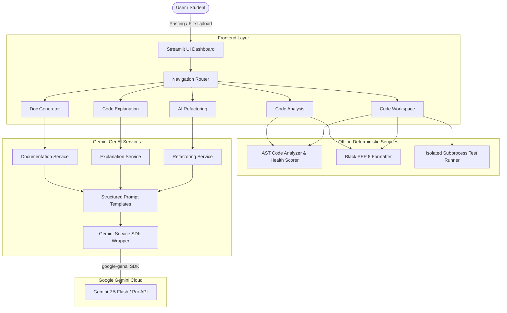

# CodeMate AI — AI-Powered Code Refactoring & Documentation Assistant

> A modern, beginner-friendly developer productivity tool and learning assistant powered by Google Gemini, Python AST, and Black.

[](https://www.python.org/)
[](https://github.com/psf/black)
[](https://pytest.org/)
[](https://streamlit.io/)

---

## 1. Project Overview

**CodeMate AI** is an intelligent developer productivity and learning platform designed to help students, bootcamp participants, and beginner software engineers write clean, idiomatic, PEP 8-compliant Python code.

Rather than acting as an opaque "black-box" code generator, CodeMate AI functions as a patient programming mentor:
- It inspects code structure and syntax using native Python Abstract Syntax Trees (AST).
- It provides instant, offline code health scoring and detects common code smells.
- It leverages Google Gemini models to refactor code while **strictly preserving original program behavior**.
- It demystifies logic through relatable, intuitive real-world analogies and step-by-step execution traces.
- It generates publication-grade `README.md` files and PEP 257 / Google-style docstrings.

---

## 2. Problem Statement

Beginner Python developers often struggle with:
1. **The "Working Code" Trap:** Code functions correctly for basic inputs, but contains subtle bugs, cryptic variable names (`x`, `y`, `tmp`), and non-standard styling.
2. **Abstract Feedback:** Linter warnings (e.g., `W0611`, `C0103`) can be confusing or intimidating without clear explanations of *why* they matter.
3. **Over-Engineering in AI Tools:** Many GenAI tools produce complex, senior-level abstractions (metaclasses, advanced generators) that overwhelm novice learners.
4. **Lack of Documentation Skills:** Writing clear docstrings, API references, and comprehensive README files is critical for career success but often neglected in beginner courses.

CodeMate AI solves these problems through an interactive, visual SaaS dashboard that couples deterministic AST inspection with guided GenAI refactoring and explanations.

---

## 3. Key Features

- **💻 Interactive Code Workspace:**
  - Real-time Python code editor with syntax highlighting and line numbers.
  - One-click drag-and-drop `.py` file uploader.
  - Curated library of educational sample programs demonstrating anti-patterns (grade calculators, inventory managers, word counters, banking systems).
  - Integrated Black formatting and bytecode syntax compilation check.
- **🔍 Deep AST Code Quality Analysis:**
  - Detects syntax errors with exact line and column coordinates.
  - Identifies missing docstrings in modules, classes, and functions.
  - Statically determines unused imports.
  - Detects PEP 8 violations in function and class naming.
  - Flags code smells (mutable default arguments, bare `except:`, long functions, deep nesting).
  - Calculates Cyclomatic Complexity and provides a 0–100 Code Health Score.
  - Operates **100% offline without requiring an API key**.
- **⚡ AI-Powered Code Refactoring (Google Gemini):**
  - Side-by-side original vs. refactored comparison.
  - Before-and-after Code Health score tracking (e.g., score improved from 58 to 98).
  - Line-by-line unified diff view.
  - Preserves program inputs, outputs, and edge cases.
  - Explains the educational rationale behind each change.
- **💡 Beginner-Friendly Code Explanation:**
  - High-level executive overview in plain English.
  - Relatable real-world analogies (e.g., comparing inventory systems to warehouse shelves).
  - Step-by-step execution flow diagram/trace.
  - Function-by-function and variable-by-variable breakdown.
- **📝 Automated Documentation Generator:**
  - Generates comprehensive, Markdown-ready `README.md` files with installation, usage, and examples.
  - Enriches Python code with Google-style docstrings and beginner-friendly inline comments.
- **🧪 Safe Subprocess Test Sandbox:**
  - Executes user test assertions in an isolated child process with strict 3-second timeouts.
  - **Security Guarantee:** Arbitrary user code is never executed inside the Streamlit host process.
- **📥 Downloadable Outputs:**
  - Export refactored Python source files (`.py`).
  - Export generated `README.md` files.
  - Export Markdown-formatted Code Analysis Reports and Explanation Reports.

---

## 4. System Architecture



---

## 5. Technology Stack

| Component | Technology | Version | Purpose |
| :--- | :--- | :--- | :--- |
| **Runtime** | Python | 3.11+ / 3.12+ | Core programming environment |
| **Web Interface** | Streamlit | 1.35.0+ | Modern reactive web UI |
| **LLM Provider** | Google Gemini API | 2.5 Flash / 1.5 Flash | AI refactoring, explanations, docs |
| **SDK** | Google GenAI SDK | 3.5.0+ | Official client for Gemini API |
| **Static Analysis** | Python `ast` | Native | AST traversal, symbol tracking, metric scoring |
| **Code Formatter** | Black | 24.0+ | PEP 8 deterministic code formatting |
| **Test Framework** | Pytest | 8.0+ | Automated unit test suite |
| **Environment** | python-dotenv | 1.0+ | Configuration and API key loading |

---

## 6. Project Folder Structure

```
codemate-ai/
│
├── app.py                      # Main Streamlit application and UI layout
├── requirements.txt            # Python dependencies
├── .env.example                # Template for environment configuration
├── .env                        # Local API keys (excluded from git)
├── README.md                   # Complete project documentation
│
├── services/                   # Business logic and processing modules
│   ├── __init__.py
│   ├── gemini_service.py       # Google GenAI SDK wrapper and error handling
│   ├── code_analyzer.py        # Python AST parser, metrics, and health scorer
│   ├── refactoring_service.py  # AI refactoring and diff generation
│   ├── explanation_service.py  # Plain-English explanations & analogies
│   ├── documentation_service.py# README and docstring generator
│   └── validation_service.py   # Syntax validation & isolated subprocess runner
│
├── prompts/                    # Carefully tuned LLM prompt templates
│   ├── __init__.py
│   ├── refactoring_prompt.py   # Prompts for clean, PEP 8 refactoring
│   ├── explanation_prompt.py   # Prompts for beginner analogies and execution flow
│   └── documentation_prompt.py # Prompts for README and docstrings
│
├── utils/                      # Reusable helpers and sample codes
│   ├── __init__.py
│   ├── file_handler.py         # File decoders, markdown exporters, diff builder
│   └── sample_codes.py         # 5 educational Python code anti-pattern samples
│
└── tests/                      # Automated Pytest suite
    ├── __init__.py
    ├── test_analyzer.py        # Tests for AST analysis, smells, and metrics
    └── test_validation.py      # Tests for syntax check, Black, and test runner
```

---

## 7. Installation Instructions

### Prerequisites
- Python 3.11 or higher installed on your system.
- Git (optional, for cloning).

### Step 1: Clone or Navigate to the Repository
```bash
cd "c:\Users\enosh\Downloads\TSB Downloads\Code Refactoring & Doc Gen Assistant"
```

### Step 2: (Recommended) Create and Activate a Virtual Environment
```bash
# On Windows PowerShell
python -m venv venv
.\venv\Scripts\Activate.ps1

# On macOS/Linux
python3 -m venv venv
source venv/bin/activate
```

### Step 3: Install Required Dependencies
```bash
pip install -r requirements.txt
```

---

## 8. Gemini API Configuration

1. Obtain a free Gemini API key from [Google AI Studio](https://aistudio.google.com/app/apikey).
2. Copy `.env.example` to `.env`:
   ```bash
   cp .env.example .env
   ```
3. Open `.env` in any text editor and insert your key:
   ```ini
   GEMINI_API_KEY=AIzaSyYourActualKeyHere
   GEMINI_MODEL=gemini-2.5-flash
   ```
4. **Alternative:** If you do not wish to create a `.env` file, you can enter your API key directly in the CodeMate AI sidebar settings inside the browser! The key is held safely in session memory and never shared.

> **Offline Mode Note:** If no Gemini API key is configured, CodeMate AI still functions fully for Code Workspace, AST Code Analysis, Black Formatting, Syntax Validation, and Isolated Subprocess Testing.

---

## 9. Running the Application

Launch the Streamlit web dashboard with:
```bash
streamlit run app.py
```

The application will start and open automatically in your browser at `http://localhost:8501`.

---

## 10. How Each Module Works

### `services/code_analyzer.py`
Parses Python source code into an Abstract Syntax Tree via `ast.parse()`. Traverses the tree using `ASTVisitor` to:
- Find missing docstrings in classes and functions via `ast.get_docstring()`.
- Record all imported identifiers (`Import`, `ImportFrom`) and compare against names loaded (`ast.Load`).
- Flag mutable default arguments (e.g., `def fn(items=[])`).
- Detect bare `except:` clauses.
- Measure line spans and nesting depth.
- Compute Cyclomatic Complexity based on branching nodes (`If`, `For`, `While`, `Try`, `BoolOp`).
- Compute a normalized 0–100 Health Score.

### `services/gemini_service.py`
Encapsulates Google GenAI SDK communications. Provides fallback handling between `google.genai` and `google.generativeai`. Implements friendly error interception for common conditions: missing keys, invalid keys, and rate-limiting (`429 ResourceExhausted`).

### `services/refactoring_service.py`
Combines static AST findings with Gemini prompt engineering. Injects detected smells into the prompt so the model targets specific flaws. Verifies the returned refactored code with AST compilation and formats with Black before displaying side-by-side comparisons and diffs.

### `services/explanation_service.py`
Prompts Gemini with structured educational directives. Formats responses into distinct modules: Executive Summary, Real-World Analogy, Execution Trace, Function Breakdown, and Beginner Watch-outs.

### `services/documentation_service.py`
Contains two operational modes:
1. `generate_project_readme()`: Synthesizes a structured GitHub-ready Markdown file.
2. `generate_code_docstrings()`: Enriches functions and classes with PEP 257 / Google docstrings and verifies syntactic validity.

### `services/validation_service.py`
Provides safety-critical validation:
- `validate_syntax()`: AST compile check without execution.
- `format_with_black()`: Format Python code to PEP 8 standards.
- `run_isolated_test_suite()`: Writes code + assertions to an ephemeral temporary file and executes in a separate `subprocess.run([sys.executable, ...])` call with a hard 3.0-second timeout.

---

## 11. Security & Safety

- **No Arbitrary Code Execution in Host Process:** CodeMate AI will **never** run `eval()`, `exec()`, or import user-provided scripts directly inside the Streamlit host server.
- **Sandboxed Subprocess Execution:** Test assertions run in ephemeral child processes with strict timeouts to prevent infinite loops, resource starvation, or accidental process crashes.
- **API Key Privacy:** Keys entered in the sidebar remain exclusively in `st.session_state` and are never exposed in HTML or client logs.

---

## 12. Unit Testing

Run the full automated test suite using Pytest:
```bash
python -m pytest -v
```

Expected output:
```
============================= test session starts =============================
collected 17 items

tests/test_analyzer.py::test_syntax_error_detection PASSED               [  5%]
tests/test_analyzer.py::test_missing_docstrings_detection PASSED         [ 11%]
tests/test_analyzer.py::test_unused_imports_detection PASSED             [ 17%]
tests/test_analyzer.py::test_naming_conventions PASSED                   [ 23%]
tests/test_analyzer.py::test_mutable_default_argument PASSED             [ 29%]
tests/test_analyzer.py::test_bare_except_detection PASSED                [ 35%]
tests/test_analyzer.py::test_deep_nesting_detection PASSED               [ 41%]
tests/test_analyzer.py::test_metrics_and_health_score PASSED             [ 47%]
tests/test_validation.py::test_validate_syntax_valid PASSED              [ 52%]
tests/test_validation.py::test_validate_syntax_invalid PASSED            [ 58%]
tests/test_validation.py::test_validate_syntax_empty PASSED              [ 64%]
tests/test_validation.py::test_black_formatting PASSED                   [ 70%]
tests/test_validation.py::test_isolated_test_runner_success PASSED       [ 76%]
tests/test_validation.py::test_isolated_test_runner_failure PASSED       [ 82%]
tests/test_validation.py::test_isolated_test_runner_timeout PASSED       [ 88%]
tests/test_validation.py::test_extract_python_code_markdown PASSED       [ 94%]
tests/test_validation.py::test_generate_diff PASSED                      [100%]

============================= 17 passed in 1.82s ==============================
```

---

## 13. Limitations

1. **Static vs. Dynamic Analysis:** AST analysis detects syntactic patterns and structure; it does not replace comprehensive test suites or formal verification of semantic runtime equivalence.
2. **Wildcard & Dynamic Imports:** Imports using `from module import *` or `importlib.import_module()` cannot be statically verified for usage.
3. **LLM Non-Determinism:** While prompt templates enforce strict constraints, LLMs may occasionally produce alternative variable naming choices. The built-in AST post-validation ensures all returned code is syntactically sound.

---

## 14. Future Enhancements

- [ ] Automated generation of Pytest test cases from AST function signatures.
- [ ] Integration with Type Checkers (Mypy static analysis).
- [ ] Multi-file Python project zip upload and analysis.
- [ ] Interactive step-through debugger visualization.
- [ ] Support for additional language targets (JavaScript, TypeScript, Go).

---

## 15. License

Distributed under the MIT License. See `LICENSE` for more information. Educational and personal use encouraged!
